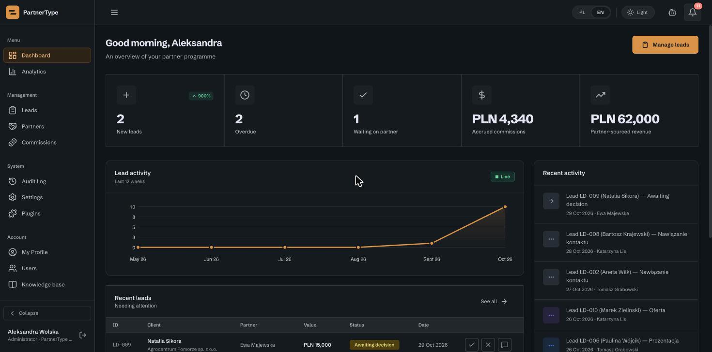
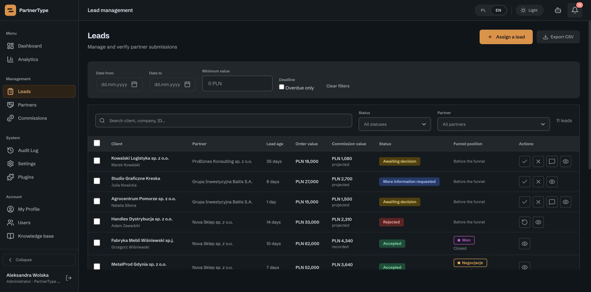
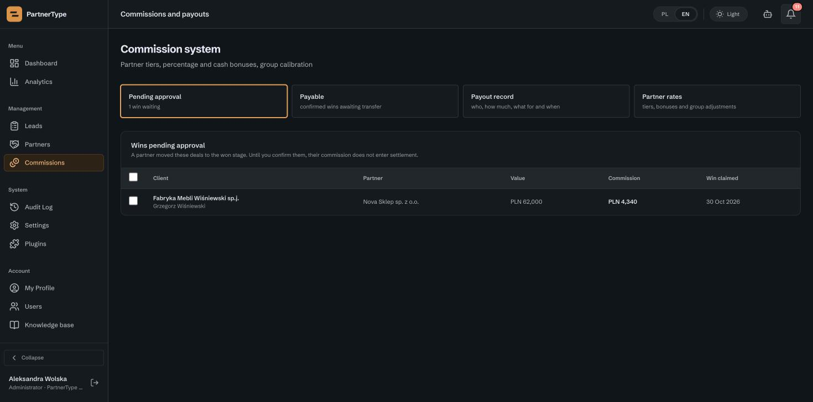

<p align="center">
  
</p>

<h1 align="center">PartnerType</h1>

<p align="center"><strong>The open-source agentic PRM. More sales through partners.</strong></p>

<p align="center">
  <a href="https://github.com/VibeCoderJK9/PartnerType/actions/workflows/ci.yml"></a>
  <a href="LICENSE"></a>
  <a href="https://github.com/VibeCoderJK9/PartnerType/releases/latest"></a>
</p>

<p align="center">
  <a href="https://partnertype.com">Website</a> ·
  <a href="#documentation">Docs</a> ·
  <a href="#quick-start">Quick start</a> ·
  <a href="CONTRIBUTING.md">Contributing</a> ·
  <a href="CHANGELOG.md">Changelog</a>
</p>

<p align="center"></p>

## What is PartnerType

PartnerType is partner relationship management (PRM) software for companies that sell through
partners. The vendor runs a partner programme. Partners register leads, and every lead moves
through the vendor's sales stages up to a won deal, a commission and a payout.

You host it yourself: on your computer, or as your own installation on your own server or private
cloud. Partner and client data stay in your database. A local AI assistant and a read-only
connector for Claude work on that same data, under the same permissions as the app.

## Key features

**Partner programme**

- Partner portal and vendor dashboard in one app.
- Lead registration with duplicate checks and a client queue.
- Your own deal stages, partner tiers and commission rules.
- Wins confirmed by the vendor, cash and percentage bonuses, payouts with history.

**For partners**

- [Knowledge base](docs/KNOWLEDGE_BASE.md): price lists, product sheets, presentations and contract
  templates for every partner (PDF, Office, PNG, JPG up to 10 MB each).
- [Affiliate programme](docs/AFFILIATE.md) (off by default): personal referral links; the shop
  reports paid orders with a signed webhook (generic HMAC or Stripe Checkout), and an approved
  order follows your commission rules.

**AI, done carefully**

- Local AI assistant (Ollama) that drafts leads and stage changes. It proposes; a person confirms
  every write with a separate click.
- Read-only MCP endpoint (`/mcp`) with OAuth 2.1 for Claude, and a REST API (`/api/v1`) with keys,
  field scopes, rate limits and a call log.

**Make it yours**

- [Blocks](docs/BLOCKS.md): small plugins that react to lead events or run on a schedule, for the
  part of your process no one else has.
- English and Polish interface, light and dark theme. A new language is two JSON files and no code.

<p align="center"></p>

## Quick start

Try the full app on your computer with demo data. You need Docker with Compose v2.

```sh
git clone https://github.com/VibeCoderJK9/PartnerType.git
cd PartnerType
docker compose -f compose.demo.yaml up --build
```

Open **http://localhost:8000** and sign in with an account printed in the log:

| Sign-in tab | E-mail | Password |
|---|---|---|
| Producer (the vendor's administrator) | `vendor@demo.partnertype.test` | `Demo2026!` |
| Partner | `partner.gold@demo.partnertype.test` (more in the log) | `Demo2026!` |

The app opens in your browser's language if it speaks it, otherwise in English.

- The demo listens only on `127.0.0.1` and uses fixed, public passwords. Never use it for real data.
- Mail and the AI model are not set up in the demo, so mail errors in the log are expected.
- Stop it with `Ctrl+C`. `docker compose -f compose.demo.yaml down -v` removes its data.

## Self-hosting in production

Each installation is its own Docker Compose project with its own PostgreSQL, secrets and
containers. The operator tool `tools/instance.py` prepares all of it, including a one-time owner
invitation link. There are no default accounts.

```sh
docker build --target release -t partnertype:local .
python3 -m tools.instance --env staging --id vendor-a create \
  --name 'Vendor A' --email owner@example.test \
  --base-url https://a.localhost:8443 --port 8443 \
  --image "$(docker image inspect partnertype:local --format '{{.Id}}')"
```

Add `--skip-model` to start without the local AI model and install it later. Backups are encrypted
with `age` and can be checked with a restore drill.

- [docs/DEPLOYMENT.md](docs/DEPLOYMENT.md): the short path, health check and the checklist before
  real data.
- [docs/operations/INSTANCES.md](docs/operations/INSTANCES.md): create, upgrade, back up and restore
  an installation.
- [docs/operations/PUBLIC-SERVER.md](docs/operations/PUBLIC-SERVER.md): from a rented Linux server to
  HTTPS with Let's Encrypt, or behind your own reverse proxy.

## AI assistant and MCP

**Local first.** The assistant runs on Ollama inside your installation, with a small open model
(`partnerhub-agent`, built from the `Modelfile`). There is no cloud AI fallback. Prompts and tool
results go only to Ollama on `127.0.0.1`. CRM notes are treated as data, never as instructions.

**The AI proposes, a human confirms.** Every change is shown as a summary card. Only a separate,
signed-in click on a short-lived token carries it out. A typed "yes" in the chat is never a
confirmation. Partners can only read their own leads and prepare a new lead.

**Claude and other AI clients.** The gateway is off by default. An administrator switches it on
in Settings › Integrations and chooses which data groups are visible. Then:

- claude.ai, Claude Desktop and the mobile app connect with **Connect** (OAuth 2.1, PKCE). The
  password never reaches Claude.
- Claude Code and your own scripts use an API key (`ptk_…`) with a fixed lifetime.
- Eight read-only MCP tools and six REST routes, with the same role rules as the app. A partner
  sees only their own data.

Guides: [docs/MCP.md](docs/MCP.md) (connecting, tools, limits) ·
[docs/AGENT-LOCAL-SETUP.md](docs/AGENT-LOCAL-SETUP.md) (Ollama and the model) ·
OpenAPI 3.1 description in [docs/openapi.json](docs/openapi.json).

## Architecture

| Layer | Technology |
|---|---|
| Backend | Python 3.12, Flask, gunicorn |
| Database | PostgreSQL 17, Alembic migrations, row-level security |
| Frontend | Plain JavaScript, HTML and CSS; no build step; strict Content Security Policy |
| AI | Ollama with a local open model |
| Delivery | Docker image, one Compose project per installation, Caddy for HTTPS |

Code map: `api/` server and business rules, `api/gateway/` MCP, OAuth and `/api/v1`, `js/` and
`pages/` the screens, `migrations/` the schema, `tools/` and `deploy/` operator tooling. The rules
every change must respect are in [ARCHITECTURE.md](ARCHITECTURE.md).

<p align="center"></p>

## Security

- **Isolation in the database.** PostgreSQL row-level security keeps partners apart: a partner
  cannot read another partner's leads, comments, payouts or bonuses, even if a query forgets its
  filter. Without a user context, protected tables return nothing.
- **Least privilege.** The app connects with a restricted database role that cannot change the
  schema. The audit log is append-only.
- **Safe rendering.** Text typed by people is always shown as text, never as HTML.
- **Checked on every change.** Over 4,000 automated tests run in CI, with a gate against unreviewed
  HTML sinks.

Found a vulnerability? Please do not open a public issue. Follow [SECURITY.md](SECURITY.md).

## Translations

PartnerType speaks English and Polish. A new language is two JSON files (`locales/<code>.json` and
`api/locale/<code>.json`) and no code; anything not yet translated falls back to English.
[TRANSLATING.md](TRANSLATING.md) walks you through it, and `python3 -m tools.i18n_coverage` shows
how complete each language is.

## Documentation

| Guide | What it covers |
|---|---|
| [docs/DEPLOYMENT.md](docs/DEPLOYMENT.md) | Running an installation and the health check |
| [docs/operations/INSTANCES.md](docs/operations/INSTANCES.md) | Instances, upgrades, backups, restore |
| [docs/operations/PUBLIC-SERVER.md](docs/operations/PUBLIC-SERVER.md) | Public server with HTTPS |
| [docs/MCP.md](docs/MCP.md) | Claude, MCP, OAuth and `/api/v1` |
| [docs/AGENT-LOCAL-SETUP.md](docs/AGENT-LOCAL-SETUP.md) | The local AI assistant |
| [docs/BLOCKS.md](docs/BLOCKS.md) | Writing blocks (plugins) |
| [docs/AFFILIATE.md](docs/AFFILIATE.md) | The affiliate programme |
| [docs/KNOWLEDGE_BASE.md](docs/KNOWLEDGE_BASE.md) | The knowledge base |
| [ARCHITECTURE.md](ARCHITECTURE.md) | Architecture rules for contributors |

## Contributing

Bug reports, fixes, documentation, translations and new blocks are welcome.

- Questions and ideas: [Discussions](https://github.com/VibeCoderJK9/PartnerType/discussions).
- Read [CONTRIBUTING.md](CONTRIBUTING.md) for how to run the tests and the rules for code.
- Open an issue first for bigger changes.
- Every change goes through a pull request, which runs CI and is reviewed by the maintainer.
- Please follow the [code of conduct](CODE_OF_CONDUCT.md).

Changes are listed in [CHANGELOG.md](CHANGELOG.md).

## Licence

PartnerType is free software under the [GNU Affero General Public License v3.0](LICENSE).
You may use, change and self-host it for free, also for commercial work. If you let people use a
changed version over a network, you must offer them its source code under the same licence.

Prefer not to host it yourself? Write to [kontakt@partnertype.com](mailto:kontakt@partnertype.com).

© 2026 PartnerType
